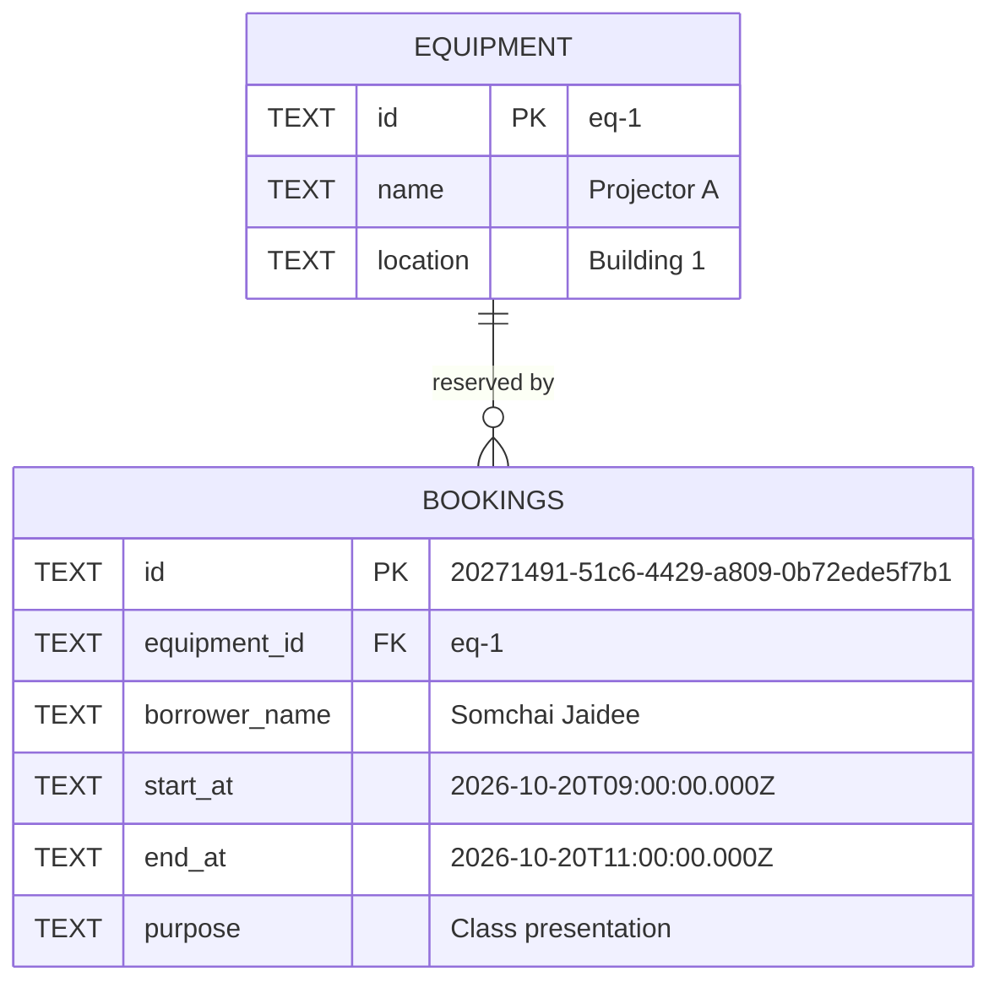

# Data Model / ERD — Faculty Shared-Equipment Booking API

Designed **before** implementation, as the brief requires. Target:
**Cloudflare D1 (SQLite)** bound to a Hono Worker written in TypeScript.

---

## 1. Entities

Two tables. This is the schema actually deployed — `migrations/0001_create_equipment_and_bookings.sql`.

### `equipment`

| Column | Type | Key | Null | Example |
| --- | --- | --- | --- | --- |
| `id` | TEXT | **PK** | NOT NULL | `eq-1` |
| `name` | TEXT | | NOT NULL | `Projector A` |
| `location` | TEXT | | NOT NULL | `Building 1` |

### `bookings`

| Column | Type | Key | Null | Example |
| --- | --- | --- | --- | --- |
| `id` | TEXT | **PK** | NOT NULL | `20271491-51c6-4429-a809-0b72ede5f7b1` |
| `equipment_id` | TEXT | **FK → equipment.id** | NOT NULL | `eq-1` |
| `borrower_name` | TEXT | | NOT NULL | `Somchai Jaidee` |
| `start_at` | TEXT | | NOT NULL | `2026-10-20T09:00:00.000Z` |
| `end_at` | TEXT | | NOT NULL | `2026-10-20T11:00:00.000Z` |
| `purpose` | TEXT | | NOT NULL | `Class presentation` |

### DDL (exactly what runs)

```sql
CREATE TABLE equipment (
  id TEXT PRIMARY KEY,
  name TEXT NOT NULL,
  location TEXT NOT NULL
);

CREATE TABLE bookings (
  id TEXT PRIMARY KEY,
  equipment_id TEXT NOT NULL,
  borrower_name TEXT NOT NULL,
  start_at TEXT NOT NULL,
  end_at TEXT NOT NULL,
  purpose TEXT NOT NULL,
  FOREIGN KEY (equipment_id) REFERENCES equipment(id)
);

-- Supporting indexes (no effect on the API contract, they only make the
-- overlap check fast: it always filters by equipment, then compares times).
CREATE INDEX idx_bookings_equipment_start ON bookings (equipment_id, start_at);
CREATE INDEX idx_bookings_equipment_end   ON bookings (equipment_id, end_at);
```

Timestamps are stored as TEXT in the single fixed format
`YYYY-MM-DDTHH:mm:ss.sssZ` (UTC). Fixed width + UTC means lexicographic order
**is** chronological order, so `<` / `>` compare instants correctly.

---

## 2. Relationship

One equipment item has **many** bookings; every booking belongs to exactly one
item. `equipment_id` is a real foreign key, so the database itself refuses an
orphan booking.

```
EQUIPMENT                         BOOKINGS
+----------------+                +-------------------+
| PK id     TEXT |eq-1  1      N  | PK id          TEXT|
|    name   TEXT |-------------->|    equipment_id FK  |
|    location TEXT|              |    borrower_name    |
+----------------+                |    start_at         |
                                  |    end_at           |
  1 physical item per row.        |    purpose          |
  ids look like "eq-1".           +-------------------+
                                    1 row = 1 time slot.
                                    ids are crypto.randomUUID() UUIDs.
```



The cardinality is the point of the design: **many bookings may exist for one
piece of equipment — but never two whose time ranges overlap.**

---

## 3. The overlap rule

Two bookings for the **same equipment** may not overlap. Intervals are
half-open `[start_at, end_at)`, so one booking may end exactly when the next
one starts.

```sql
-- POST (the lab's exact three-parameter form):
SELECT id, start_at, end_at
  FROM bookings
 WHERE equipment_id = ?
   AND start_at < ?          -- existing start  <  requested end
   AND end_at   > ?          -- existing end    >  requested start
 LIMIT 1;

-- PATCH adds one more bound parameter so the row being edited is ignored:
--   ... AND id <> ?
```

Every value is a **bound parameter** (`?`) — request data is never
concatenated into SQL text, anywhere in the codebase.

### Worked examples (equipment `eq-1`)

| Existing | New | Result |
| --- | --- | --- |
| 09:00–11:00 | 10:00–12:00 | `409` — overlaps |
| 09:00–11:00 | 08:00–10:00 | `409` — overlaps |
| 09:00–11:00 | 11:00–13:00 | `201` — touching, allowed |
| 09:00–11:00 | 07:00–09:00 | `201` — touching, allowed |
| 09:00–11:00 (`eq-1`) | 10:00–12:00 on `eq-2` | `201` — different item, never conflicts |

### Known limitation (documented, not a bug)

Conflict detection is **check, then insert**. Two requests racing in the same
millisecond could both pass the check. D1 offers no exclusion constraint and
no multi-row interactive transaction to close that window, so the
application-level check is the strongest control available here. A production
design would serialise writes per equipment item.

---

## 4. Where the data lives

| Instance | Identifier | Purpose |
| --- | --- | --- |
| Remote D1 | `faculty-booking-db` (`23f181b2-57b2-4cd2-b8d1-1f605a7b5f3d`) | Serves the **deployed** Worker — this is what the graded `curl` tests hit |
| Local D1 | same name, under `.wrangler/state/` | Development only |

Both are created from `migrations/` and loaded from `seed.sql`.

## 5. Seed data

| id | name | location |
| --- | --- | --- |
| `eq-1` | Projector A | Building 1 |
| `eq-2` | Camera A | Media Room |

Two equipment records (the brief's minimum), and no bookings — so the first
`POST /api/bookings` in a test run creates row 1.
